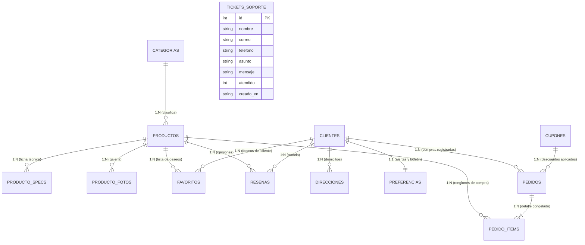

# 📘 Documentación Técnica de la Base de Datos SQLite (13 Tablas en 3FN)
## NEXUS GEAR MX — Proyecto de Comercio Electrónico (7.° Semestre)

---

## 1. Resumen Ejecutivo de la Arquitectura

La tienda virtual **NEXUS GEAR MX** ha sido transformada de un sitio estático a una **aplicación web dinámica cliente-servidor** respaldada por una base de datos relacional **SQLite 3**, con backend en **Python (Flask)** y frontend en **HTML5, CSS3 y Vanilla JavaScript**.

- **Motor de Base de Datos:** SQLite 3.50+ (`tienda.db`)
- **Backend API:** Python 3.14 + Flask (Servicio REST JSON)
- **Frontend:** Single-origin con sincronización en tiempo real vía `fetch()`
- **Integridad Referencial:** Control estricto mediante `PRAGMA foreign_keys = ON;`
- **Normalización:** 100% en Tercera Forma Normal (3FN)

---

## 2. Diagrama de Relaciones Entidad-Relación (ER)



---

## 3. Diccionario de Datos Completo (13 Tablas)

### 1. `categorias` (Filtro del catálogo y navegación)
| Campo | Tipo SQLite | Restricciones / Notas |
| :--- | :--- | :--- |
| `id` | INTEGER | PRIMARY KEY AUTOINCREMENT |
| `nombre` | TEXT | UNIQUE, NOT NULL (ej. "Teclados Mecánicos") |
| `slug` | TEXT | UNIQUE, NOT NULL (ej. "teclados") |

### 2. `productos` (Catálogo maestro de inventario)
| Campo | Tipo SQLite | Restricciones / Notas |
| :--- | :--- | :--- |
| `id` | INTEGER | PRIMARY KEY AUTOINCREMENT |
| `categoria_id` | INTEGER | NOT NULL, FK → `categorias(id)` ON DELETE RESTRICT |
| `nombre` | TEXT | NOT NULL |
| `marca` | TEXT | NOT NULL (ej. "Razer", "Logitech G") |
| `subcategoria` | TEXT | ej. "Inalámbricos", "65% Compacto" |
| `descripcion` | TEXT | Ficha comercial detallada |
| `precio` | REAL | NOT NULL, CHECK (`precio >= 0`) |
| `precio_original` | REAL | NULL si no hay descuento; valor previo si hay oferta |
| `conectividad` | TEXT | CHECK (`conectividad IN ('Inalámbrico', 'Alámbrico', 'Sin conexión')`) |
| `etiqueta_conexion` | TEXT | ej. "Bluetooth 5.0 / USB-C" |
| `rgb` | INTEGER | 0 o 1 |
| `retiro_villahermosa` | INTEGER | 0 o 1 (disponibilidad en Tabasco 2000) |
| `envio_gratis` | INTEGER | 0 o 1 |
| `publico` | TEXT | CHECK (`publico IN ('gamer', 'estudiante', 'ambos')`) |
| `tipo_ilustracion` | TEXT | Identificador de vector de respaldo (headset, keyboard, mouse...) |
| `stock` | INTEGER | NOT NULL, CHECK (`stock >= 0`) |
| `stock_flash` | INTEGER | Existencia para cintillo de Ofertas Flash |
| `popularidad` | INTEGER | Score numérico para ordenamiento por tendencia |
| `fecha_alta` | TEXT | Fecha ISO (`YYYY-MM-DD`) |
| `foto` | TEXT | Nombre base del archivo de foto (ej. `razer-orochi-v2`) |
| `activo` | INTEGER | 1 = visible en tienda, 0 = descontinuado |

> **Nota de normalización:** Las calificaciones promedio y el conteo de opiniones no se almacenan como columnas fijas; se calculan dinámicamente mediante `ROUND(AVG(calificacion), 1)` y `COUNT(id)` sobre la tabla `resenas`.

### 3. `producto_specs` (Ficha técnica y especificaciones)
| Campo | Tipo SQLite | Restricciones / Notas |
| :--- | :--- | :--- |
| `id` | INTEGER | PRIMARY KEY AUTOINCREMENT |
| `producto_id` | INTEGER | NOT NULL, FK → `productos(id)` ON DELETE CASCADE |
| `etiqueta` | TEXT | NOT NULL (ej. "Sensor", "Batería", "Switches") |
| `valor` | TEXT | NOT NULL (ej. "Óptico Razer Focus X, 18,000 DPI") |
| `orden` | INTEGER | Secuencia visual para mostrarlas en orden |

### 4. `producto_fotos` (Galería fotográfica de producto)
| Campo | Tipo SQLite | Restricciones / Notas |
| :--- | :--- | :--- |
| `id` | INTEGER | PRIMARY KEY AUTOINCREMENT |
| `producto_id` | INTEGER | NOT NULL, FK → `productos(id)` ON DELETE CASCADE |
| `archivo` | TEXT | NOT NULL (ej. `hyperx-cloud-ii-2.jpg`) |
| `orden` | INTEGER | Posición en el carrusel de miniaturas |

### 5. `usuarios` (Usuarios registrados y administradores)
| Campo | Tipo SQLite | Restricciones / Notas |
| :--- | :--- | :--- |
| `id` | INTEGER | PRIMARY KEY AUTOINCREMENT |
| `nombre` | TEXT | NOT NULL |
| `correo` | TEXT | NOT NULL, UNIQUE (índice único) |
| `password_hash` | TEXT | NOT NULL (cifrado con sal mediante Werkzeug PBKDF2:SHA256) |
| `telefono` | TEXT | Teléfono de contacto |
| `rol` | TEXT | CHECK (`rol IN ('cliente', 'admin')`), DEFAULT 'cliente' |
| `creado_en` | TEXT | Timestamp ISO |

### 6. `direcciones` (Libreta de domicilios de envío)
| Campo | Tipo SQLite | Restricciones / Notas |
| :--- | :--- | :--- |
| `id` | INTEGER | PRIMARY KEY AUTOINCREMENT |
| `usuario_id` | INTEGER | NOT NULL, FK → `usuarios(id)` ON DELETE CASCADE |
| `calle` | TEXT | NOT NULL (calle y número exterior/interior) |
| `colonia` | TEXT | Fraccionamiento o colonia |
| `ciudad` | TEXT | NOT NULL (ej. "Villahermosa") |
| `estado` | TEXT | NOT NULL (ej. "Tabasco") |
| `cp` | TEXT | NOT NULL, TEXT (preserva ceros iniciales como `06700`) |
| `referencias` | TEXT | Indicaciones para paquetería |
| `principal` | INTEGER | 1 = predeterminada, 0 = secundaria |

### 7. `preferencias` (Alertas y boletines, relación 1:1)
| Campo | Tipo SQLite | Restricciones / Notas |
| :--- | :--- | :--- |
| `usuario_id` | INTEGER | PRIMARY KEY, FK → `usuarios(id)` ON DELETE CASCADE |
| `alertas_whatsapp` | INTEGER | 0 o 1 (notificaciones de guía y recolección) |
| `boletin` | INTEGER | 0 o 1 (promociones estudiantiles y ofertas) |

### 8. `cupones` (Descuentos y promociones escolares)
| Campo | Tipo SQLite | Restricciones / Notas |
| :--- | :--- | :--- |
| `id` | INTEGER | PRIMARY KEY AUTOINCREMENT |
| `codigo` | TEXT | NOT NULL, UNIQUE (ej. `ESTUDIANTE10`, `NEXUS100`) |
| `tipo` | TEXT | NOT NULL, CHECK (`tipo IN ('porcentaje', 'monto')`) |
| `valor` | REAL | NOT NULL, 10 (%) o 100 ($ MXN) |
| `activo` | INTEGER | 1 = vigente, 0 = inhabilitado |
| `vence_en` | TEXT | Fecha límite `YYYY-MM-DD` |

### 9. `pedidos` (Órdenes de compra y tracking)
| Campo | Tipo SQLite | Restricciones / Notas |
| :--- | :--- | :--- |
| `id` | INTEGER | PRIMARY KEY AUTOINCREMENT |
| `folio` | TEXT | NOT NULL, UNIQUE (ej. `NX-48213`) |
| `usuario_id` | INTEGER | FK → `usuarios(id)` ON DELETE SET NULL (NULL para compras de invitados) |
| `nombre_contacto` | TEXT | NOT NULL (snapshot del nombre al comprar) |
| `correo_contacto` | TEXT | NOT NULL (snapshot de correo para comprobante) |
| `telefono_contacto` | TEXT | NOT NULL (snapshot para WhatsApp/paquetería) |
| `tipo_envio` | TEXT | NOT NULL, CHECK (`tipo_envio IN ('domicilio', 'retiro_villahermosa')`) |
| `calle`, `colonia`, `ciudad`, `cp`, `referencias` | TEXT | Copia inmutable del domicilio usado al pagar |
| `estado_republica` | TEXT | Estado geográfico (evita colisión de nombres con el estatus) |
| `rfc` | TEXT | Opcional, solo si solicitó factura |
| `metodo_pago` | TEXT | NOT NULL, CHECK (`metodo_pago IN ('tarjeta', 'oxxo', 'contra_entrega')`) |
| `meses_msi` | INTEGER | CHECK (`meses_msi IN (1, 3, 6)`), DEFAULT 1 |
| `cupon_id` | INTEGER | FK → `cupones(id)` ON DELETE SET NULL |
| `subtotal` | REAL | Suma de productos sin descuento ni flete |
| `descuento` | REAL | Monto descontado por cupón |
| `envio` | REAL | Costo de flete ($0.00 en Villahermosa o compras > $999, $149 nacional) |
| `total` | REAL | Monto final cobrado |
| `estado` | TEXT | "Pagado", "En camino vía FedEx", "Listo en Villahermosa", "Entregado" |
| `guia` | TEXT | Número de rastreo de paquetería |
| `creado_en` | TEXT | Fecha y hora ISO de creación |

### 10. `pedido_items` (Partidas y renglones de la compra)
| Campo | Tipo SQLite | Restricciones / Notas |
| :--- | :--- | :--- |
| `id` | INTEGER | PRIMARY KEY AUTOINCREMENT |
| `pedido_id` | INTEGER | NOT NULL, FK → `pedidos(id)` ON DELETE CASCADE |
| `producto_id` | INTEGER | FK → `productos(id)` ON DELETE SET NULL |
| `nombre_producto` | TEXT | Copia del nombre comercial al momento de comprar |
| `cantidad` | INTEGER | NOT NULL, CHECK (`cantidad > 0`) |
| `precio_unitario` | REAL | NOT NULL, precio congelado en el instante de compra |

### 11. `favoritos` (Lista de deseos del cliente)
| Campo | Tipo SQLite | Restricciones / Notas |
| :--- | :--- | :--- |
| `usuario_id` | INTEGER | NOT NULL, FK → `usuarios(id)` ON DELETE CASCADE |
| `producto_id` | INTEGER | NOT NULL, FK → `productos(id)` ON DELETE CASCADE |
| **PK Compuesta** | `(usuario_id, producto_id)` | Impide duplicados de un mismo producto en favoritos |

### 12. `resenas` (Opiniones y valoraciones de usuarios)
| Campo | Tipo SQLite | Restricciones / Notas |
| :--- | :--- | :--- |
| `id` | INTEGER | PRIMARY KEY AUTOINCREMENT |
| `producto_id` | INTEGER | NOT NULL, FK → `productos(id)` ON DELETE CASCADE |
| `usuario_id` | INTEGER | FK → `usuarios(id)` ON DELETE SET NULL (NULL para compras demo) |
| `autor` | TEXT | NOT NULL, nombre del autor visible en pantalla |
| `calificacion` | INTEGER | NOT NULL, CHECK (`calificacion BETWEEN 1 AND 5`) |
| `comentario` | TEXT | NOT NULL |
| `creado_en` | TEXT | Timestamp ISO |

### 13. `tickets_soporte` (Mesa de ayuda y contacto)
| Campo | Tipo SQLite | Restricciones / Notas |
| :--- | :--- | :--- |
| `id` | INTEGER | PRIMARY KEY AUTOINCREMENT |
| `nombre` | TEXT | NOT NULL |
| `correo` | TEXT | NOT NULL |
| `telefono` | TEXT | Teléfono de contacto |
| `asunto` | TEXT | NOT NULL |
| `mensaje` | TEXT | NOT NULL |
| `atendido` | INTEGER | 0 = pendiente, 1 = resuelto |
| `creado_en` | TEXT | Timestamp ISO |

---

## 4. Decisiones Técnicas y Normalización (Para Exponer en Clase)

1. **Precios congelados en `pedido_items` (Integridad Histórica):**
   Si la tienda sube mañana el precio de un teclado de $1,127 a $1,350 MXN, los pedidos viejos no deben modificarse. Por eso se copia el `precio_unitario` al momento de la venta.
2. **El Carrito de compras no tiene tabla en la Base de Datos:**
   Tanto el carrito activo como "Guardar para después" residen en `LocalStorage` en el navegador del usuario. Solo se envían al servidor en el momento exacto en que el usuario hace clic en *Confirmar Pago*. Esto ahorra miles de lecturas/escrituras en el servidor por carritos abandonados.
3. **Seguridad y Cumplimiento PCI-DSS:**
   Nunca se guarda el número de tarjeta (PAN), fecha de expiración ni CVV en la base de datos local. En producción se utiliza una pasarela tokenizada; nuestra base solo guarda el método (`tarjeta`, `oxxo`, `contra_entrega`) y los meses sin intereses.
4. **Compras de Invitados:**
   Cualquier visitante puede comprar sin registrarse. El campo `usuario_id` en `pedidos` queda en `NULL`, pero la tabla guarda obligatoriamente el nombre, correo y teléfono del comprador.
5. **Normalización en Tercera Forma Normal (3FN):**
   Todas las tablas tienen llaves primarias únicas y no existen dependencias transitivas ni multivaluadas. Las calificaciones de productos no son estáticas, sino calculadas con funciones de agregación (`AVG` y `COUNT`). La copia de dirección en `pedidos` no viola la 3FN porque es una **fotografía histórica temporal inmutable**.
6. **Resolución de la colisión de nombres (`estado_republica` vs `estado`):**
   En la tabla `pedidos`, para evitar la colisión de nombres entre el estado geográfico ("Tabasco", "CDMX") y el estatus del pedido ("Pagado", "En camino"), el campo geográfico se nombró `estado_republica` y el estatus se nombró `estado`.
7. **`PRAGMA foreign_keys = ON;`:**
   En SQLite las llaves foráneas están desactivadas por defecto por razones históricas de compatibilidad. En `database.py` se activa automáticamente en cada conexión para forzar la validación de integridad referencial.
8. **Sin usuarios predeterminados en el seed:**
   La base de datos no crea cuentas de prueba ni contraseñas conocidas. Los pedidos y reseñas semilla quedan como invitado (`usuario_id = NULL`); las cuentas reales se registran con `/api/auth/register`.
9. **`/cuenta.html` protegido por sesión:**
   El panel de usuario no muestra datos de ejemplo. Si no hay sesión activa, la vista pide iniciar sesión o crear cuenta; con sesión, carga pedidos, direcciones, preferencias y favoritos desde la API.
10. **Visor de base de datos solo para administradores:**
   `/bd.html`, `/api/bd/tablas`, `/api/bd/tabla/<tabla>` y `/api/bd/sql` requieren una sesión con `rol='admin'`. El registro público siempre crea `rol='cliente'`; para crear o promover un administrador se usa el script local `backend/scripts/crear_admin.py`.

---

## 5. Matriz de Cumplimiento de Secciones (PDF "Secciones Tienda Virtual")

A continuación se detalla el cumplimiento estricto de cada una de las 7 secciones especificadas en el documento oficial del proyecto escolar:

| Sección del PDF | Característica Solicitada | Estado | Archivo / Componente | Tabla SQLite Vinculada |
| :--- | :--- | :---: | :--- | :--- |
| **1. Página de Inicio** | Productos destacados y ofertas | ✅ | `index.html` (Hero, Ofertas Flash, Best Sellers) | `productos` (`stock_flash`, `popularidad`) |
| | Categorías principales | ✅ | `index.html` (Grid de 6 categorías con arte) | `categorias` (`slug`, `nombre`) |
| | Testimonios o elementos de confianza | ✅ | `index.html` (Reseñas verificadas y Value Strip) | `resenas` (`autor`, `calificacion`) |
| | Newsletter signup | ✅ | `index.html` (Formulario Clan Nexus + Cupón $100) | `cupones` (`NEXUS100`) |
| **2. Catálogo de Productos** | Navegación por categorías y subcategorías | ✅ | `catalogo.html` (Pills y Sidebar dinámico) | `categorias` y `productos(subcategoria)` |
| | Filtros avanzados (precio, marca, características) | ✅ | `catalogo.html` (Slider precio, marcas, RGB, conectividad) | `productos` (`precio`, `marca`, `rgb`, etc.) |
| | Organización (precio, popularidad, novedad) | ✅ | `catalogo.html` (Selector sort: menor/mayor precio, rating, fecha) | `productos` (`precio`, `popularidad`, `fecha_alta`) |
| | Vista tipo parrilla o lista | ✅ | `catalogo.html` (Botones Grid/List interactivos) | Renderizado dinámico en `app.js` |
| | Búsqueda inteligente con autocompletar | ✅ | Header global (Buscador con dropdown predictivo) | Búsqueda en `productos` (`nombre`, `marca`) |
| **3. Producto Individual** | Galería de imágenes de alta calidad con zoom | ✅ | `producto.html` (Lupa interactiva + galería) | `producto_fotos` (`archivo`, `orden`) |
| | Descripción detallada y especificaciones técnicas | ✅ | `producto.html` (Pestaña Ficha Técnica) | `producto_specs` (`etiqueta`, `valor`) |
| | Reseñas y calificaciones de usuarios | ✅ | `producto.html` (Calificaciones + Formulario de reseña) | `resenas` (`AVG(calificacion)`, `COUNT(id)`) |
| | Productos relacionados/recomendados | ✅ | `producto.html` (Recomendaciones inteligentes) | `productos` (misma categoría) |
| | Opciones de variantes (switches, color) | ✅ | `producto.html` (Píldoras interactivas de variantes) | Selectores con feedback visual en `app.js` |
| | Información de stock y disponibilidad | ✅ | `producto.html` (Stock en tiempo real y cálculo por C.P.) | `productos(stock)` y fletes calculados |
| **4. Carrito de Compras** | Vista detallada de productos seleccionados | ✅ | `carrito.html` y Drawer lateral | Partidas en `appState.cart` |
| | Modificación de cantidades | ✅ | `carrito.html` (Steppers + / - y eliminación) | Control reactivo de subtotales |
| | Cálculo de envío en tiempo real | ✅ | `carrito.html` (Barra envío gratis > $999 y C.P.) | Reglas de paquetería y retiro Villahermosa |
| | Códigos de descuento | ✅ | `carrito.html` (Validador de cupones escolares) | `cupones` (`ESTUDIANTE10`, `NEXUS100`) |
| | Guardado para usuarios registrados | ✅ | `carrito.html` (Sección "Guardar para después") | Persistencia y traslado con 1 clic |
| **5. Proceso de Checkout** | Checkout de una sola página o pasos mínimos | ✅ | `checkout.html` (Flujo limpio en 3 pasos) | Transacción atómica en `POST /api/pedidos` |
| | Checkout como invitado | ✅ | `checkout.html` (Compra sin login obligatorio) | `pedidos(usuario_id = NULL)` |
| | Resumen claro del pedido | ✅ | `checkout.html` (Desglose de subtotal, cupón, flete, total) | Snapshot histórico de montos |
| | Políticas de envío y devolución visibles | ✅ | `checkout.html` (Garantía 12 meses y tiempos FedEx) | Términos y plazos explícitos |
| | Módulo y Métodos de pago | ✅ | `checkout.html` (Tarjeta con tarjeta animada, OXXO, Contra entrega) | `pedidos(metodo_pago, meses_msi)` |
| **6. Dashboard de Usuario** | Historial de pedidos | ✅ | `cuenta.html` (Pestaña de órdenes realizadas) | `pedidos` y `pedido_items` |
| | Tracking de envíos | ✅ | `cuenta.html` (Timeline de 4 etapas + Guía FedEx) | `pedidos(estado, guia)` |
| | Lista de deseos | ✅ | `cuenta.html` (Pestaña de favoritos del cliente) | `favoritos` (PK compuesta cliente/producto) |
| | Información personal y direcciones | ✅ | `cuenta.html` (Perfil y libreta de domicilios) | `usuarios` y `direcciones` |
| | Preferencias de comunicación | ✅ | `cuenta.html` (Alertas WhatsApp y boletín) | `preferencias` (1:1 con cliente) |
| **7. Atención al Cliente** | Chat en vivo o chatbot | ✅ | Widget global "Nexus Bot 24/7" | Respuestas contextuales Tabasco/tienda |
| | Centro de ayuda/FAQ | ✅ | `ayuda.html` (Buscador y acordeón de preguntas) | Base de conocimiento integrada |
| | Formulario de contacto | ✅ | `ayuda.html` (Mesa de ayuda con folio TK-xxxx) | `tickets_soporte` |
| | Políticas claras (devoluciones, garantía, privacidad)| ✅ | `ayuda.html` (Términos legales y devoluciones 30 días) | Sección legal y de garantías |
| | Información de la empresa | ✅ | `ayuda.html` (Plaza Atenas, Tabasco 2000, horario, WhatsApp) | Datos comerciales y fiscales |

---

## 6. Instrucciones de Ejecución

### Opción 1: Ejecutar con el archivo por lotes (Recomendada en Windows)
Haz doble clic en el archivo `iniciar_tienda.bat`. Este script:
1. Verifica e inicializa la base de datos `tienda.db` si aún no existe.
2. Levanta el servidor Flask en `http://localhost:5000`.
3. Abre automáticamente tu navegador predeterminado.

### Opción 2: Ejecutar mediante consola
```bash
# 1. Inicializar la base de datos y sembrar datos de prueba
python backend/database.py

# 2. Iniciar el servidor web
python backend/server.py
```

### Opción 3: Ejecutar la suite de pruebas automatizadas
Para verificar ante el profesor que todos los endpoints y tablas funcionan:
```bash
python backend/scripts/test_api.py
```

### Crear un usuario administrador (una sola vez)
Como el registro público solo crea cuentas `cliente`, el administrador se crea desde la consola local:

```bash
python backend/scripts/crear_admin.py admin@tutienda.mx TuPasswordSegura --nombre "Admin Tienda"
```

Después inicia sesión en `/cuenta.html` con ese correo.

### Acceso al Visor Interactivo de la Base de Datos
Solo disponible para usuarios con `rol='admin'`. Abre en tu navegador:
👉 **`http://localhost:5000/bd.html`**
Allí podrás:
- Inspeccionar las 13 tablas en tiempo real con sus conteos de filas.
- Hacer clic en cualquier tabla para ver sus columnas, tipos de datos y registros.
- Ejecutar consultas interactivas `SELECT` en la consola SQL integrada.

Si no eres administrador, la página te redirige a `/cuenta.html` y las APIs `/api/bd/*` responden `403`.
